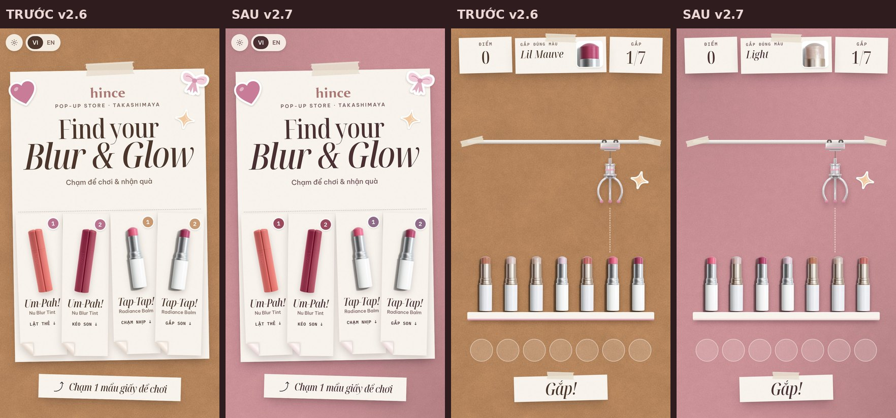
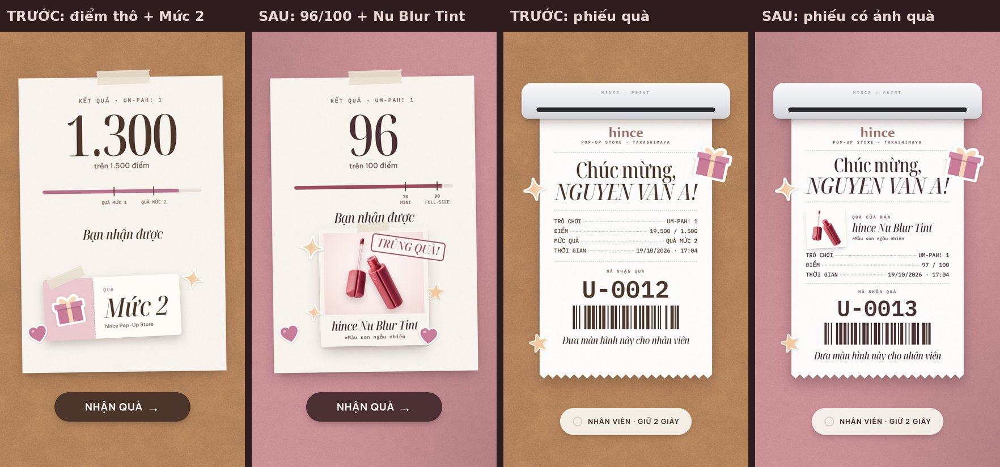
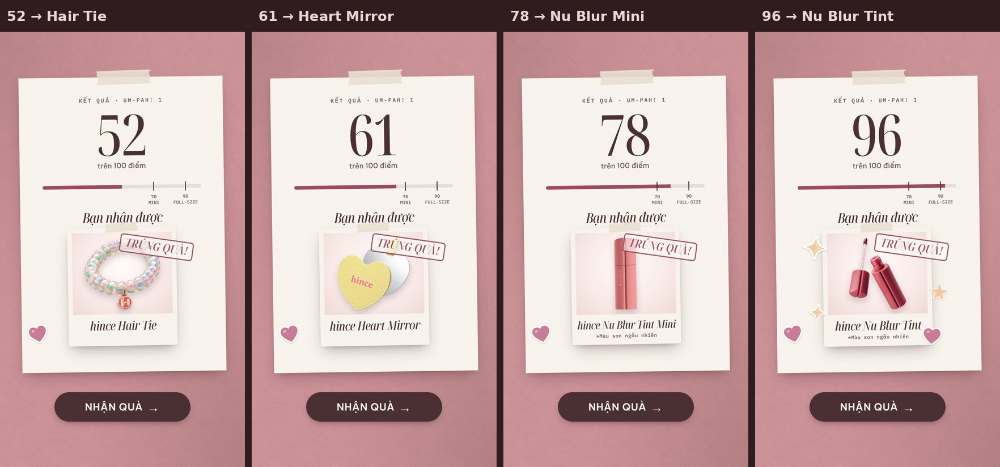
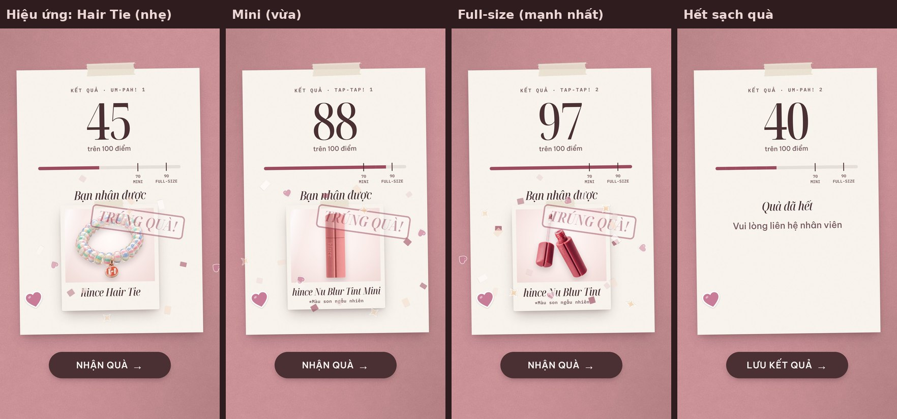
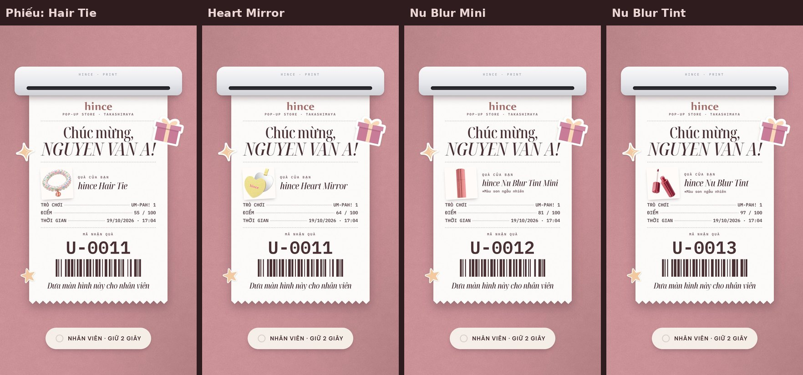
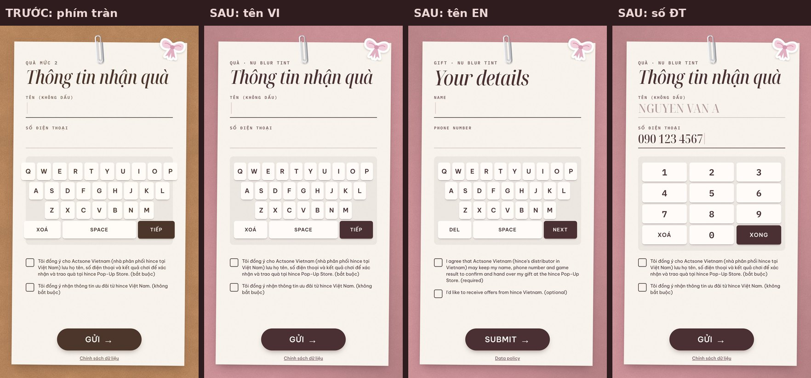
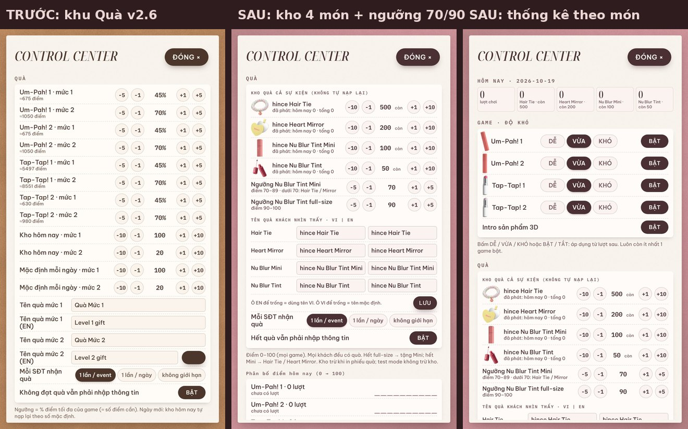

# Báo cáo v2.7 — hince LED Game

Ngày: 19/10/2026 · Nhánh: `v2.7` (Pull Request vào `main`, **chưa merge** — `main` vẫn là bản live)
Người đọc: đại ca Sói (PM). Spec gốc: `_dev/TASK_v2_7.md`.

---

## 1. Tóm tắt nhanh

| Việc | Kết quả |
|---|---|
| Theme hồng "Rose" | ✅ Nền giấy hồng phấn mới, chữ mauve-cocoa, nhấn berry (Um-Pah!) / plum (Tap-Tap!). Giữ nguyên phong cách giấy & sticker. |
| Điểm 0–100 + 3 mức quà | ✅ Khách luôn thấy điểm 0–100 (HUD, kết quả, phiếu quà). Ai chơi cũng có quà: <70 Hair Tie/Mirror · 70–89 Mini · 90–100 Nu Blur Tint. |
| Kho quà 500 / 200 / 100 / 50 | ✅ Kho tổng cả sự kiện, không tự nạp mỗi ngày. Hết thì tự hạ mức, không bao giờ tặng cao hơn điểm. |
| Màn trúng quà có ảnh + hiệu ứng | ✅ Polaroid rơi xuống, ảnh quà nảy + vệt sáng, pháo giấy, con dấu "TRÚNG QUÀ!". Full-size ăn mừng to nhất. |
| Phiếu quà có ảnh quà | ✅ Ảnh ~160 px cạnh tên quà để nhân viên đối chiếu; quà son ghi "*Màu son ngẫu nhiên". |
| Sửa bàn phím tràn khung | ✅ Cả 3 bàn phím (tên VI, tên EN, số ĐT) nằm gọn trong tờ giấy, cách mép ≥ 32 px. |
| Kiểm tra | ✅ 27 + 39 test logic, 17 kiểm tra chạy thật trên Chromium (cả `file://` và offline), 27 ảnh chụp 1080×1920. |

---

## 2. Ảnh chụp chính (1080×1920, Chromium)

**Trước / sau theme**


**Màn kết quả + phiếu quà: trước / sau**


**4 món quà trên màn kết quả** (điểm ép bằng công cụ test)


**Hiệu ứng đang chạy** (Hair Tie nhẹ → Mini vừa → Full-size mạnh nhất) + trường hợp hết sạch quà


**Phiếu quà 4 món**


**Bàn phím: trước (tràn) / sau (3 kiểu)**


**Control Center — khu Quà**


Toàn bộ ảnh lẻ: thư mục [`shots/`](shots/) — file `before_v26_*` là bản cũ (lấy từ commit trước khi sửa), còn lại là v2.7:
màn chờ (`01`), hướng dẫn (`02`), đang chơi 4 game (`03`), kết quả 4 món + hết quà + hiệu ứng giữa chừng (`04`), form 3 bàn phím VI/EN (`05`), phiếu quà 4 món + hết quà (`06`), cảm ơn (`07`), Control Center (`08`).

---

## 3. Bảng màu cuối cùng

Dùng đúng mã trong spec, **không phải chỉnh ±1 bậc** (chụp thấy đã hài hoà).

| Vai trò | Mã v2.6 | **Mã v2.7** |
|---|---|---|
| Nền (ảnh `assets/v27/bg/bg_rose_paper.jpg`) | `#B6845D` toffee | **`#C99196`** (giữa ảnh đo được `#C99096`; góc trên-trái `#B88488`, dưới-phải `#B58185`, 2 góc còn lại `#CA9197`) |
| Chữ chính / nút đậm (`--ink`, `--cocoa`) | `#4C362B` | **`#4A2F33`** |
| Chữ phụ (`--ink2`) | `#7D6458` | **`#7A5A5E`** |
| Chữ rất phụ (`--ink3`) | `#B19C91` | **`#B39A9C`** |
| Thẻ giấy (`--paper`, `--cream`) | `#FBF4EC` | **`#FBF3F0`** |
| Trắng (`--white`) | `#FFFBF7` | **`#FFFBF9`** |
| Nhấn Um-Pah!, con dấu, badge (`--rose`) | `#B8728D` | **`#9C4A5E`** berry |
| Nhấn sáng (`--rose-soft`, `--azalea`) | `#DFA6BB` | **`#EDD7D4`** blush |
| Highlight (`--champ`, `--butter`, `--lilac-soft`) | `#F8D8B9` | **`#F6DDCC`** |
| Nhấn Tap-Tap! (`--tap`, `--lilac`) | `#C99A72` | **`#8E6A88`** plum |
| Chữ Tap-Tap! (`--tapText`) | `#9C6A44` | **`#6E4E69`** |
| Bóng đổ | `rgba(76,54,43,x)` | **`rgba(74,47,51,x)`** |
| Nền ngoài khung | `#2B1D16` | **`#2E1C1F`** |

Màu phụ em tự quy đổi theo cùng tinh thần (spec không ghi): quầng hồng khi ghép đúng thẻ `rgba(196,120,138,x)`; bóng đậm `rgba(46,24,30,x)`; mép cong vé, lỗ lò xo sổ tay chuyển sang kem ánh hồng (`#E8D3D2`, `#DEC8C9`…). Thỏi son vàng (Gleaming) giữ màu vàng vì là màu sản phẩm.

Ảnh/video có nền toffee "nướng" sẵn:
- `assets/video/reveal/reveal_nublur_toffee.mp4`, `reveal_balm_toffee.mp4` (video intro dự phòng cho trình duyệt không phải Chrome). Vì có bản WebM nền trong suốt, em **nướng lại 2 video lên nền hồng** (`reveal_nublur_rose.mp4`, `reveal_balm_rose.mp4`, nhẹ hơn ½) thay vì đóng khung polaroid, và xoá 2 file toffee. Trên Chrome (máy LED) vẫn dùng WebM trong suốt như cũ.
- Các ảnh khác trong `assets/v26/` (sticker, đầu son, ảnh cảm ơn, ảnh poster) đều nền trong suốt hoặc nằm trong khung giấy sẵn → không lộ toffee. Vân giấy `paper.jpg` đo được `#F8F1EF` — vốn đã là kem ánh hồng, giữ nguyên.

---

## 4. Checklist theo spec

### Mục 1 — Theme hồng
- ✅ Thay toàn bộ biến `:root` + mã màu viết cứng trong CSS, HTML, canvas Tap-Tap! 1.
- ✅ Nền giấy hồng mới tạo từ vân giấy cũ (±4 %, gradient chéo 2 góc), 1080×1920, 148 KB. Script: `_dev/tests/make_rose_bg.py`.
- ✅ Kiểm tra ảnh/video nền toffee (xem trên).

### Mục 2 — Điểm 100 + 3 mức quà + kho
- ✅ `score100 = round(100 × điểm / điểm tối đa)`, chặn 0–100; **100 chỉ khi chơi hoàn hảo** (99,6 % vẫn là 99).
- ✅ HUD 4 game, số "+điểm" bật lên khi ghép đúng, màn kết quả, phiếu quà đều hiện thang 100.
- ✅ Bỏ ngưỡng % riêng từng game → ngưỡng chung 70 / 90, chỉnh trong Control Center.
- ✅ Không đổi luật chơi, thời gian, độ khó.
- ✅ Mức 1 random Hair Tie / Mirror theo số còn lại (test 10.000 lượt: lệch ≤ 3 %; rút hết 700 món thì 2 món hết gần như cùng lúc).
- ✅ Hết hàng: full → Mini → Hair Tie/Mirror; còn 1 trong 2 món thì chỉ tặng món còn; hết sạch → "Quà đã hết – vui lòng liên hệ nhân viên". Không bao giờ tặng cao hơn mức điểm. Bị hạ mức → phiếu ghi chú.
- ✅ Mỗi SĐT 1 quà giữ nguyên (khách đã nhận quà ở v2.6 vẫn bị chặn ở v2.7).
- ✅ Quà được chọn 1 lần ở màn kết quả, giữ tới phiếu quà; kho trừ khi phiếu quà được phát (như cũ).
- ✅ Control Center: 4 dòng kho (còn lại · đã phát hôm nay · tổng, nút −10 −1 +1 +10), 2 ô ngưỡng 70/90, tên quà VI | EN; thống kê "HÔM NAY" theo 4 món.
- ✅ Dữ liệu: `score` (gốc), `maxScore`, `scorePct` = điểm 0–100 (số nguyên), `tier` 1/2/3, `giftKey`, `giftName`. **Không thêm/bớt/đổi cột Google Sheet** (vẫn 23 cột như cũ; `giftKey` chỉ lưu trong máy).
- ✅ Máy đã chạy v2.6: lần đầu mở v2.7 tự chuyển sang kho 500/200/100/50 (không cộng số cũ), bỏ ngưỡng % cũ + tên "Quà Mức 1/2"; các cài đặt khác (âm thanh, tên máy, PIN, link Sheet…) giữ nguyên. `appVersion` = `2.7.0`.
- ✅ Test mới cho mọi quy tắc trong `_dev/tests/logic.test.js`.

### Mục 3 — Màn trúng quà
- ✅ 4 ảnh quà tối ưu: `assets/v27/gifts/` (WebP dùng chính + PNG dự phòng, 28–206 KB/file, cạnh dài ≤ 900 px). Ảnh gốc 1–2 MB không đưa vào app.
- ✅ Sau khi số đếm xong: polaroid rơi + xoay −6° → 2° → −1° (~700 ms), ảnh nảy 0,6 → 1,06 → 1 + bóng mềm, vệt sáng lướt chéo, pháo giấy (mảnh giấy, tim, lấp lánh: blush / berry / champagne / trắng), tên quà serif nghiêng + con dấu "TRÚNG QUÀ!" / "YOU WIN!".
- ✅ Ăn mừng theo quà: Hair Tie/Mirror 12 mảnh · Mini 18 · Full-size 24 mảnh + 2 vệt sáng + 4 sticker lấp lánh quanh thẻ.
- ✅ Quà son: "*Màu son ngẫu nhiên" / "*Shade is random" (mono 22 px, màu chữ phụ) ở màn kết quả và phiếu quà.
- ✅ Phiếu quà có ảnh quà ~160 px cạnh tên quà.
- ✅ Chỉ dùng CSS (transform/opacity), không thư viện. Chạm vào màn trong lúc hiệu ứng → nhảy tới trạng thái cuối. Hẹn giờ tự về màn chờ giữ nguyên.
- ✅ Ảnh mới có trong danh sách offline `sw.js`.

### Mục 4 — Bàn phím
- ✅ Độ rộng phím tính theo khung (1/10 hàng), khung cách mép trong tờ giấy 70 px mỗi bên (test đo được ~100 px kể cả độ nghiêng tờ giấy), phím cao 96–104 px, chữ không bị cắt. Áp dụng tên VI, tên EN, số ĐT (VI + EN).

### Mục 5 — Chung
- ✅ `config.js` appVersion `2.7.0`; `sw.js` VERSION `hince-led-v2.7` + đủ file mới.
- ✅ Không đổi luật chơi, Google Sheet / Apps Script, VI | EN, icon, PIN, cấu trúc màn.
- ✅ Mọi chữ mới có VI + EN trong `js/i18n.js`.
- ✅ `config.local.js` không đụng (vẫn trống). Không có link / mã bí mật nào trong repo.

### Mục 6 — Kiểm tra
- ✅ `node _dev/tests/logic.test.js` (27 pass) và `node _dev/tests/logic2.test.js` (39 pass).
- ✅ `_dev/tests/flow_v27.js` — 17 kiểm tra chạy thật trên Chromium: chơi → kết quả → bấm phím nhập tên/SĐT → phiếu quà; kho trừ đúng; trùng SĐT; hết full-size; hết sạch; cột CSV/Sheet; chạm bỏ qua hiệu ứng; HUD 0–100 (lật thẻ thật); 3 bàn phím trong khung; chuyển dữ liệu máy v2.6; **mở qua `file://` không lỗi console**; **offline**: service worker cache `hince-led-v2.7`, tắt mạng tải lại vẫn chạy.
- ✅ Ảnh chụp 1080×1920: `_dev/tests/shots_v27.js` (ảnh "trước" chụp bằng cùng script trên commit cũ).

Lệnh chạy lại (từ thư mục repo):
```
node _dev/tests/logic.test.js && node _dev/tests/logic2.test.js
NODE_PATH=$(npm root -g) node _dev/tests/flow_v27.js
NODE_PATH=$(npm root -g) node _dev/tests/shots_v27.js && python3 _dev/tests/contact_v27.py
```

---

## 5. Việc đại ca cần làm sau khi merge

1. **Google Sheet Dashboard**: cột không đổi, nhưng **ý nghĩa `tier` đổi** → sửa công thức đếm:
   - `tier` = 1 → Hair Tie **hoặc** Heart Mirror (phân biệt bằng cột `giftName`), 2 → Nu Blur Tint Mini, 3 → Nu Blur Tint full-size, 0 → không nhận (trùng SĐT / hết quà, xem cột `reason`).
   - `scorePct` giờ là **điểm 0–100 số nguyên** (trước là % có lẻ — cùng thang nên biểu đồ phân bố điểm vẫn dùng được).
   - Dòng cũ từ v2.6 (cột `appVersion` < 2.7) có `tier` 1/2 theo nghĩa cũ → nên lọc theo `appVersion` nếu gộp chung.
2. **Trên máy LED** sau khi merge: mở game, vào Control Center kiểm tra dòng "Phiên bản" = **v2.7.0** và kho = **500 / 200 / 100 / 50**. Nếu vẫn thấy bản cũ: bấm "TẢI LẠI APP" 1–2 lần (service worker tự lấy bản mới).
3. **Đếm quà thực tế** trước ngày 27/11 và chỉnh kho trong Control Center cho khớp nếu khác số trên.
4. Trước khi mở cửa: tắt Test mode, "XOÁ LƯỢT TEST".
5. Duyệt lại câu chữ mới (VI/EN) nếu muốn đổi giọng: "TRÚNG QUÀ!", "*Màu son ngẫu nhiên", "Quà đã hết – Vui lòng liên hệ nhân viên", "Quà mức cao đã hết – bạn nhận món quà này nhé".

---

## 6. Rủi ro / giả định em đã tự quyết

1. **Tên nhánh**: làm trên nhánh `v2.7` như yêu cầu (bản sao cùng commit cũng có ở nhánh làm việc của phiên Claude).
2. **Điểm 100 = hoàn hảo**: nếu làm tròn ra 100 mà chưa đủ điểm tối đa thì hiện 99.
3. **Tap-Tap! 1**: điểm tối đa lấy đúng bản nhạc của lượt đó (mỗi lượt khác nhau một chút) → 100 chỉ khi chạm hoàn hảo bản nhạc đó.
4. **Test mode**: chọn quà từ một kho "ảo" đầy đủ 500/200/100/50 và **không trừ kho thật** (giống v2.6: test không ảnh hưởng kho).
5. **Trùng SĐT**: chỉ biết khi khách nhập SĐT, nên màn kết quả vẫn hiện quà; phiếu quà sau đó báo "ĐÃ NHẬN QUÀ – Mỗi SĐT nhận quà 1 lần" (như v2.6).
6. **Kho thay đổi giữa màn kết quả và lúc gửi form** (vd. nhân viên chỉnh kho): giữ món đã chọn nếu còn; nếu hết thì chọn lại từ cùng mức trở xuống.
7. **Hết sạch quà ở màn kết quả**: hiện "Quà đã hết / Vui lòng liên hệ nhân viên", nút "LƯU KẾT QUẢ" → vẫn nhập tên/SĐT (theo cài đặt "Hết quà vẫn phải nhập thông tin", mặc định BẬT).
8. **"Đã phát"** trong Control Center = số phiếu quà đã in (đúng thời điểm trừ kho), không phải số lần nhân viên giữ nút 2 giây.
9. **Chạm trong lúc hiệu ứng**: lần chạm đó chỉ bỏ qua hiệu ứng, không bấm nút "NHẬN QUÀ" (tránh khách lỡ tay bỏ qua màn quà). Hiệu ứng tổng ~3 giây sau khi vào màn.
10. **Số "+điểm" bật lên trong game** (Um-Pah! 1/2, Tap-Tap! 2) cũng đổi sang thang 100 (vd. "+10") cho khớp HUD.
11. **Tên quà cũ "Quà Mức 1/2"** đã lưu trên máy v2.6 bị bỏ khi chuyển sang v2.7 (dùng tên 4 món mới).
12. **Ảnh quà**: WebP là bản chính (nét, nhẹ), PNG 256 màu chỉ để dự phòng cho trình duyệt rất cũ.
13. **Sửa thêm 1 lỗi có sẵn từ v2.6**: chữ trên các nút Control Center (LƯU, GỬI NGAY, KIỂM TRA, CSV…) cùng màu nền nên không đọc được → đã sửa.
14. **Commit theo phần**: các commit giữa chừng (vd. "scoring" trước "gift reveal") không chạy độc lập được; cần merge cả PR.
15. Hiệu ứng mới đã kiểm tra trên Chromium desktop; chưa đo FPS trực tiếp trên màn LED 43" (chỉ dùng transform/opacity nên dự kiến mượt) — [Unverified] nên chạy thử 1 lượt trên máy thật trước sự kiện.

---

## 7. File đã đổi / thêm

- Code: `index.html`, `css/style.css`, `js/app.js`, `js/logic.js`, `js/config.js`, `js/store.js`, `js/admin.js`, `js/i18n.js`, `js/assets.js`, `js/umpah1.js`, `js/umpah2.js`, `js/taptap.js`, `js/taptap2.js`, `sw.js`, `manifest.webmanifest` (màu theme).
- Ảnh/video mới: `assets/v27/bg/bg_rose_paper.jpg`, `assets/v27/gifts/*` (8 file), `assets/video/reveal/reveal_*_rose.mp4`. Xoá: `reveal_*_toffee.mp4`.
- Công cụ dev: `_dev/tests/make_rose_bg.py`, `make_gifts.py`, `shots_v27.js`, `flow_v27.js`, `contact_v27.py`; test `logic.test.js` cập nhật.
